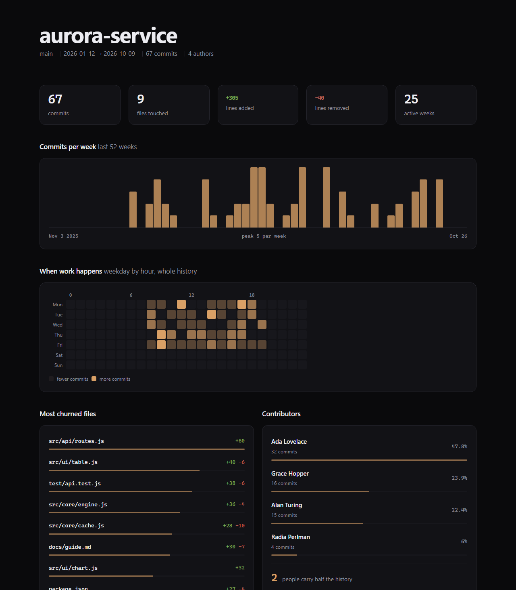

# gitpulse

One command turns a git repository into a single HTML dashboard: commits per week, when
work actually happens, the files that keep changing, and how concentrated the history is
in a few people.

Zero dependencies. Node 18+. No build step, no server, no analytics.

```
gitpulse . -o report.html --open
```



## Why

`git log --graph` tells you what happened; it does not tell you where the churn is, whether
the week you just had was normal, or that two people wrote most of the code. Most tools that
answer those questions want you to upload your repository first. gitpulse runs `git log`,
does the arithmetic locally, and writes one file you can commit, email, or open offline.

## Install

```sh
# from source
git clone https://github.com/wangtianbao-debug/gitpulse
cd gitpulse
node bin/gitpulse.js ../your-repo -o pulse.html

# or link it globally, no registry needed
npm link
gitpulse ~/code/app
```

Requires `git` on `PATH` and Node 18 or newer.

## Usage

```
gitpulse [repo] [options]

  -o, --out <file>     write the dashboard here (default: gitpulse.html)
  -w, --weeks <n>      weeks on the trend chart (default: 52)
      --since <date>   only count commits since, e.g. "12 weeks ago"
      --title <name>   override the repository name shown in the header
      --json           print summary statistics as JSON instead of HTML
      --stdout         print the HTML document to stdout
      --open           open the dashboard after writing it
  -q, --quiet          no output on success
  -h, --help           show this help
  -v, --version        show the version
```

Examples:

```sh
gitpulse                                  # current directory
gitpulse ~/code/app --weeks 26 --open
gitpulse . --since "90 days ago" -o q3.html
gitpulse . --json | jq '.commits, .busFactor'
```

## What it measures

| Figure | Definition |
| --- | --- |
| Commits per week | Buckets start Monday 00:00 UTC, `-w` weeks back from today |
| Peak week | Largest number of commits in any bucket shown |
| Weekday by hour | Commit distribution on a 7 × 24 grid, whole history |
| Most churned files | Ranked by added + deleted lines (`--numstat`) |
| Contributors | Commits, share, bus factor |
| Bus factor | How many top authors together account for 50% of commits |
| Active weeks | Weeks in the window that contain at least one commit |
| Largest changes | The six commits touching the most lines |

Merge commits are counted but contribute no line stats — that is what `git log --numstat`
reports, and it is the honest number. Binary files count as a touched file with zero lines.

## Design notes

- **One file, no scripts.** The HTML contains inline CSS and no JavaScript. It opens offline,
  renders in any browser, and is safe to attach to a ticket.
- **Colours come from tokens.** Everything is a custom property on `:root`; changing the
  accent is one line. Data-driven tints use `color-mix()` against the same tokens.
- **Accessible by default.** `:focus-visible` outlines, a `prefers-reduced-motion` fallback
  for the entry animation, and no text baked into images.
- **Numbers are monospaced, prose is not.** Tabular figures keep columns from jittering.

## Library use

```js
import { build } from 'gitpulse';

const { stats, html } = build({ repo: '/path/to/repo', weeks: 26 });
console.log(stats.totalCommits, stats.busFactor);
```

`build()` returns the aggregated `stats` object and the rendered `html` string, so a
dashboard can be generated in CI without shelling out.

## Tests

```sh
npm test
```

The suite covers log parsing (including binary files, merges and hostile subjects), the
aggregation math (weekly buckets, heat map indexing, bus factor), the renderer's escaping
and its no-network guarantee, and the CLI end to end against a throwaway repository.

## CI

The workflow lives at `ci/ci.yml` rather than `.github/workflows/ci.yml`, because pushing
workflow files needs a token with the `workflow` scope. To enable it, copy the file:

```sh
mkdir -p .github/workflows && cp ci/ci.yml .github/workflows/ci.yml
```

## License

MIT — see [LICENSE](LICENSE).
